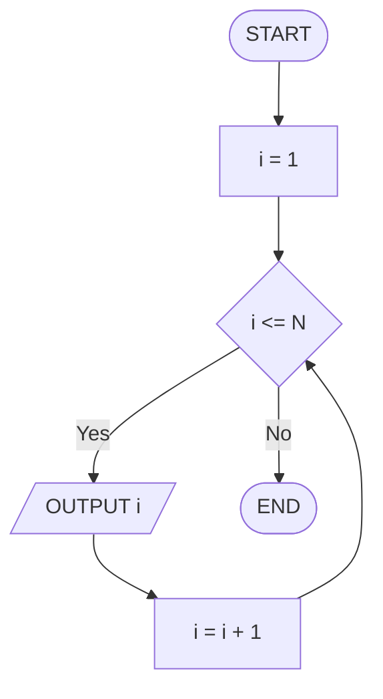
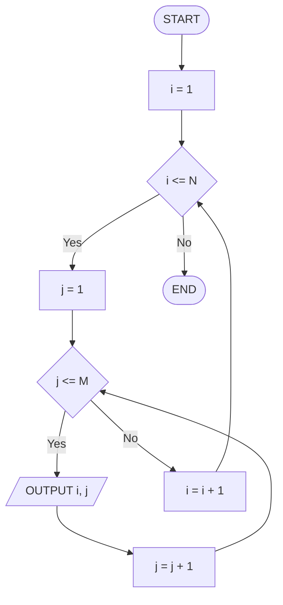

## Séance 4

Boucles (2) : FOR et boucles imbriquées

[→ Quiz](quiz_seance_04.html)
[→ Exercices](exercices_seance_04.html)

---

## Pourquoi un `FOR` ?

Parfois le nombre d'itérations est **connu à l'avance** :

- afficher les entiers de 1 à N,
- répéter une action **exactement** N fois,
- parcourir une plage avec un pas fixe (`STEP`).

`WHILE` / `REPEAT` restent utiles quand l'arrêt dépend d'une **condition ouverte**.  
Quand la plage est claire : boucle **`FOR`**.

---

## `FOR … TO … END FOR`

On fixe une **variable de contrôle**, une **borne de départ**, une **borne d'arrivée**.

<div class="two-cols">

<div>

```text
FOR i = 1 TO N DO
  OUTPUT i
END FOR
```

</div>

<div>

| Élément | Rôle |
| --- | --- |
| `FOR` | démarre la boucle |
| `i` | variable de contrôle (*loop variable*) |
| `1 TO N` | plage inclusive |
| `DO` … `END FOR` | corps |

Par défaut, le pas (*step*) vaut **+1** : `i` passe à `i + 1` après chaque itération.

</div>

</div>

---

## Equivalent `WHILE`

Un `FOR` classique se réécrit ainsi :

```text
i = 1
WHILE i <= N DO
  OUTPUT i
  i = i + 1
END WHILE
```

Trois étapes (déjà vues en S3) :

1. **initialiser** la variable de contrôle
2. **tester** la borne
3. **mettre à jour** après le corps

`FOR` regroupe ces trois gestes en une seule structure.

---

## `FOR` en *flowchart*

Même idée qu'un `WHILE` : test avant le corps, puis retour avec mise à jour.

<div class="two-cols">

<div>

- Losange : **Yes** → corps, puis `i = i + 1`, retour au test
- **No** → on sort

Bornes **inclusives** : avec `N = 3`, on affiche `1`, `2`, `3`.

</div>

<div class="max-mermaid-lg">



</div>

</div>

---

## `STEP` : changer le pas

On peut avancer (ou reculer) d'un pas différent de 1.

<div class="two-cols">

<div>

```text
FOR i = 2 TO 10 STEP 2 DO
  OUTPUT i
END FOR
```

Affiche : `2`, `4`, `6`, `8`, `10`.

</div>

<div>

```text
FOR i = 5 TO 1 STEP -1 DO
  OUTPUT i
END FOR
```

Compte à rebours : `5`, `4`, `3`, `2`, `1`.

</div>

</div>

Règle : tant que la variable de contrôle **n'a pas dépassé** la borne d'arrivée dans le sens du `STEP`, on continue.

---

<!-- _class: compact -->

## Trace table : `FOR` simple

```text
FOR i = 1 TO 3 DO
  OUTPUT i
END FOR
```

| Itération | `i` début | Corps | `i` après |
| --- | ---: | --- | ---: |
| 1 | 1 | `OUTPUT 1` | 2 |
| 2 | 2 | `OUTPUT 2` | 3 |
| 3 | 3 | `OUTPUT 3` | 4 |
| stop | 4 | test `4 <= 3` → sortie | |

Affichage : `1`, `2`, `3`. La valeur `4` sert seulement à **quitter**.

---

## Quand choisir `FOR` ?

`FOR` convient quand :

- le **nombre d'itérations** (ou la plage) est **connu** avant d'entrer,
- la variable de contrôle suit une **progression régulière** (`+1`, `-1`, `STEP`),
- on n'a **pas** besoin d'une condition métier complexe au milieu.

Exemples typiques :

- « pour chaque entier de 1 à N »
- « répéter exactement N fois »
- « parcourir un tableau (*array*) »

---

## Choisir : `FOR` / `WHILE` / `REPEAT`

| Situation | Boucle |
| --- | --- |
| Plage connue, pas régulier | **`FOR`** |
| Condition avant, 0 itération possible | **`WHILE`** |
| Au moins une itération, puis test d'arrêt | **`REPEAT … UNTIL`** |
| Sentinelle / validation de saisie | souvent `WHILE` ou `REPEAT` |
| Compteur simple 1..N | **`FOR`** (plus clair qu'un `WHILE`) |

Même problème souvent exprimable de plusieurs façons : on choisit la forme **la plus lisible**.

---

## Exemple : somme 1..N avec `FOR`

Accumulateur + plage connue = duo classique.

```text
sum = 0
FOR i = 1 TO N DO
  sum = sum + i
END FOR
OUTPUT sum
```

- `sum` accumule
- `i` parcourt la plage
- Pas besoin d'un compteur séparé : `FOR` le fournit

Avec `N = 4` : `sum` vaut successivement `1`, `3`, `6`, `10`.

---

## Erreur *off-by-one*

Se tromper d'**une** unité sur les bornes : trop peu ou trop d'itérations.

Objectif : afficher les entiers de **1 à N inclus**.

| Code | Résultat pour `N = 3` |
| --- | --- |
| `FOR i = 1 TO N` | `1 2 3` (correct) |
| `FOR i = 1 TO N - 1` | `1 2` (manque `3`) |
| `FOR i = 0 TO N` | `0 1 2 3` (en trop) |
| `FOR i = 1 TO N + 1` | `1 2 3 4` (en trop) |

Toujours se demander : **première** valeur ? **dernière** ? **combien** d'itérations ?

---

## Checklist des bornes

Avant de valider un `FOR` :

1. La borne de départ est-elle la **première** valeur voulue ?
2. La borne d'arrivée est-elle **incluse** (oui, avec `TO`) ?
3. Le `STEP` va-t-il dans le **bon sens** ?
4. La dernière valeur atteinte est-elle bien celle attendue ?
5. Une ***trace table*** sur `N` petit (3 ou 4) confirme-t-elle l'affichage ?

Un *off-by-one* se voit presque toujours sur une petite trace.

---

## Boucles imbriquées (*nested loops*)

Une boucle **à l'intérieur** d'une autre.

```text
FOR i = 1 TO N DO
  FOR j = 1 TO M DO
    OUTPUT i, j
  END FOR
END FOR
```

- Boucle **externe** (*outer*) : `i`
- Boucle **interne** (*inner*) : `j`

Pour **chaque** valeur de `i`, on parcourt **toutes** les valeurs de `j`.  
Nombre total d'itérations du corps interne : `N * M`.

---

## Trace : imbrication avec `N = 3`, `M = 2`

```text
FOR i = 1 TO 3 DO
  FOR j = 1 TO 2 DO
    OUTPUT i, j
  END FOR
END FOR
```

| `i` | `j` | Affichage |
| ---: | ---: | --- |
| 1 | 1 | `1 1` |
| 1 | 2 | `1 2` |
| 2 | 1 | `2 1` |
| 2 | 2 | `2 2` |
| 3 | 1 | `3 1` |
| 3 | 2 | `3 2` |

Ordre : on **termine** la boucle interne avant de passer au `i` suivant.

---

## Table de multiplication 1..N

Exemple typique de *nested loops* :

```text
FOR i = 1 TO N DO
  FOR j = 1 TO N DO
    OUTPUT i, "x", j, "=", i * j
  END FOR
END FOR
```

Avec `N = 3`, on obtient les produits de `1×1` jusqu'à `3×3` (9 lignes).

Idée : ligne = `i`, colonne = `j`, cellule = `i * j`.

---

<!-- _class: compact -->

## Motif en étoiles (aperçu)

Autre usage : dessiner un motif ligne par ligne.

```text
FOR row = 1 TO N DO
  line = ""
  FOR col = 1 TO row DO
    line = line + "*"
  END FOR
  OUTPUT line
END FOR
```

Avec `N = 4` :

```text
*
**
***
****
```

La borne interne dépend de la variable **externe** (`row`) : imbrication utile, pas seulement deux plages fixes.

---

<!-- _class: compact -->

## Imbrication en *flowchart* (idée)

Deux niveaux = deux tests, deux retours. Sur papier, le *pseudocode* reste souvent plus lisible.

<div class="max-mermaid-lg">



</div>

---

## Pièges des boucles imbriquées

À surveiller :

- confondre variables **externe** / **interne** (`i` vs `j`)
- réinitialiser `j` **au bon endroit** (dans le corps externe, pas une seule fois avant)
- *off-by-one* **à chaque niveau** (bornes de `i` et de `j`)
- croire que le corps interne s'exécute `N + M` fois : en fait **`N * M`**

Trace sur petit `N` : le meilleur filet de sécurité.

---

## Synthèse : trois boucles

| Boucle | Test | Itérations mini | Force |
| --- | --- | ---: | --- |
| `WHILE` | avant | 0 | condition ouverte |
| `REPEAT … UNTIL` | après | 1 | « jusqu'à ce que » |
| `FOR` | avant (plage) | 0 si plage vide | compteur / plage claire |

À retenir pour la suite (S5) : parcourir un *array* se fera presque toujours avec un **`FOR`** sur les indices.

---

## Quiz

Questions pour tester la compréhension du contenu de la séance.

[→ Quiz](quiz_seance_04.html)

---

## Exercice 4.A : `FOR` avec `STEP -1`

```text
FOR i = N TO 1 STEP -1 DO
  OUTPUT i
END FOR
```

1. Compléter pour `N = 4` : quelles valeurs affichées, dans quel ordre ?
2. Réécrire l'équivalent avec un `WHILE`.

→ [Exercices](exercices_seance_04.html) § 4.A

---

## Exercice 4.B : Choisir le type de boucle

Pour chaque énoncé, choisir `FOR`, `WHILE` ou `REPEAT … UNTIL` :

1. Afficher les pairs de 2 à 20.
2. Lire un mot de passe jusqu'à ce qu'il soit correct.
3. Sommer des valeurs jusqu'à la sentinelle `-1`.
4. Répéter exactement 10 fois un message.

→ [Exercices](exercices_seance_04.html) § 4.B

---

## Exercice 4.C : Table de multiplication

Produire le *pseudocode* (boucles imbriquées) qui affiche la table `1..N` :

chaque ligne de la forme `i x j = produit`.

Optionnel : esquisse du *flowchart* pour `N` petit.

→ [Exercices](exercices_seance_04.html) § 4.C

---

## Exercice 4.D : Trace d'imbrication

```text
FOR i = 1 TO N DO
  FOR j = 1 TO N DO
    OUTPUT i, j
  END FOR
END FOR
```

Compléter la *trace table* pour `N = 3` : ordre exact des paires `(i, j)`.

→ [Exercices](exercices_seance_04.html) § 4.D

---

## Exercice 4.E : Corriger les bornes

Objectif : afficher les entiers de **first** à **last** **inclus**.

```text
FOR i = first TO last - 1 DO
  OUTPUT i
END FOR
```

1. Quel *off-by-one* ?
2. Corriger le `FOR`.
3. Donner un jeu de test (`first = 2`, `last = 5`).

→ [Exercices](exercices_seance_04.html) § 4.E
