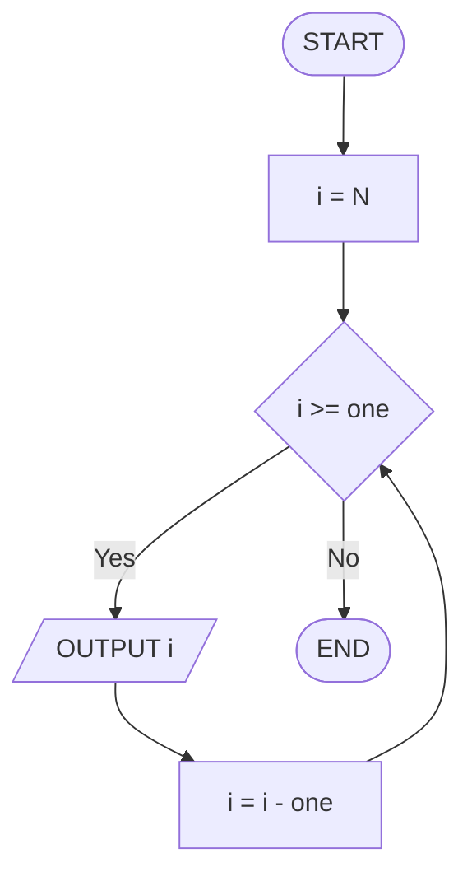
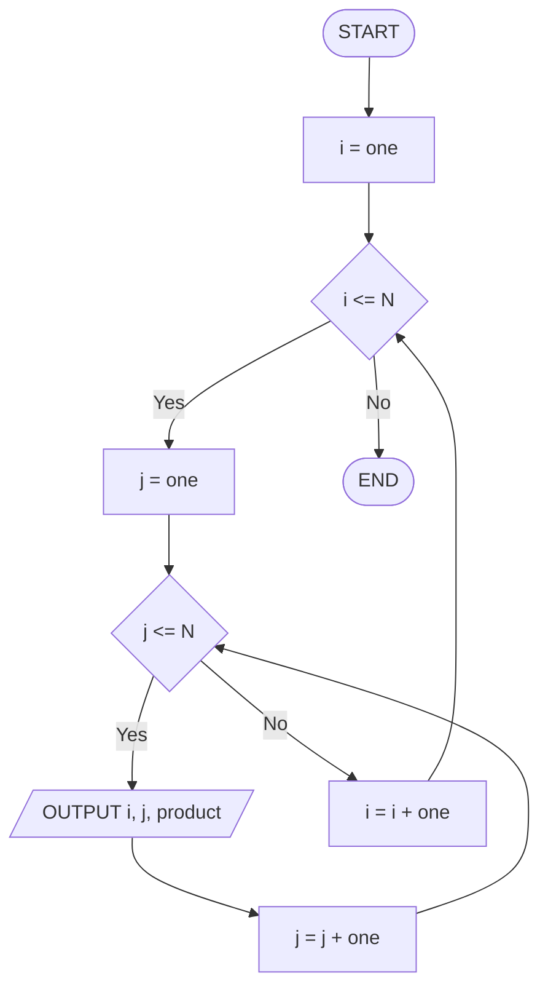

# Séance 4 — Exercices

**Thème :** Boucles (2) : FOR et boucles imbriquées  
**Support :** *pseudocode* (`FOR` / `STEP` / boucles imbriquées) + *trace table* (texte FR, *pseudocode* et *flowcharts* EN)

Dans les *flowcharts* : pas de littéraux numériques (les valeurs concrètes apparaissent **uniquement** dans la *trace table*).

<nav class="page-nav">
  <a href="cours_seance_04.html">← Cours</a>
  <a href="quiz_seance_04.html">Quiz →</a>
  <a href="../../index.html">Accueil</a>
</nav>

## 4.A : `FOR` avec `STEP -1`

Algorithme (`N` donné) :

```text
FOR i = N TO 1 STEP -1 DO
  OUTPUT i
END FOR
```

1. Compléter pour `N = 4` : quelles valeurs sont affichées, dans quel ordre ?
2. Réécrire l'équivalent avec un `WHILE`.
3. Dessiner le *flowchart* de la version `WHILE` (sans coller la valeur de `N`).

<details class="corrige">
<summary>Corrigé</summary>

Affichage : `4`, `3`, `2`, `1` (compte à rebours inclusif).

| Itération | `i` début | Corps | `i` après |
| --- | ---: | --- | ---: |
| 1 | 4 | `OUTPUT 4` | 3 |
| 2 | 3 | `OUTPUT 3` | 2 |
| 3 | 2 | `OUTPUT 2` | 1 |
| 4 | 1 | `OUTPUT 1` | 0 |
| stop | 0 | test `0 >= 1` → sortie | |

Équivalent `WHILE` :

```text
i = N
WHILE i >= 1 DO
  OUTPUT i
  i = i - 1
END WHILE
```



(`one` = 1 : valeur seulement dans la *trace*.)

</details>

---

## 4.B : Choisir le type de boucle

Pour chaque énoncé, choisir `FOR`, `WHILE` ou `REPEAT … UNTIL` (la forme la plus lisible) :

1. Afficher les pairs de 2 à 20.
2. Lire un mot de passe jusqu'à ce qu'il soit correct.
3. Sommer des valeurs jusqu'à la sentinelle `-1`.
4. Répéter exactement 10 fois un message.

<details class="corrige">
<summary>Corrigé</summary>

| # | Choix | Pourquoi |
| --- | --- | --- |
| 1 | `FOR` | Plage connue avec `STEP 2` : `FOR i = 2 TO 20 STEP 2` |
| 2 | `REPEAT … UNTIL` | Au moins une saisie, puis test d'arrêt (« jusqu'à correct ») |
| 3 | `WHILE` | Condition avant le traitement : la sentinelle ne doit pas être ajoutée |
| 4 | `FOR` | Nombre d'itérations connu à l'avance : `FOR i = 1 TO 10` |

D'autres formulations restent possibles. On privilégie la boucle **la plus claire** pour le problème.

</details>

---

## 4.C : Table de multiplication

Produire le *pseudocode* (boucles imbriquées) qui affiche la table `1..N` : chaque ligne de la forme `i x j = produit`.

Optionnel : esquisse du *flowchart* pour un `N` petit (deux niveaux de test).

<details class="corrige">
<summary>Corrigé</summary>

```text
FOR i = 1 TO N DO
  FOR j = 1 TO N DO
    OUTPUT i, "x", j, "=", i * j
  END FOR
END FOR
```

Avec `N = 3`, on obtient 9 lignes : de `1 x 1 = 1` jusqu'à `3 x 3 = 9`.  
Nombre d'exécutions du corps interne : `N * N`.



</details>

---

## 4.D : Trace d'imbrication

Algorithme :

```text
FOR i = 1 TO N DO
  FOR j = 1 TO N DO
    OUTPUT i, j
  END FOR
END FOR
```

Compléter la *trace table* pour `N = 3` : ordre exact des paires `(i, j)`.

| `i` | `j` | Affichage |
| ---: | ---: | --- |
| | | |
| | | |
| … | … | … |

<details class="corrige">
<summary>Corrigé</summary>

On **termine** la boucle interne (`j`) avant de passer au `i` suivant. Neuf paires affichées (`3 * 3 = 9` tours du corps).

| `i` | `j` | Affichage |
| ---: | ---: | --- |
| 1 | 1 | `1 1` |
| 1 | 2 | `1 2` |
| 1 | 3 | `1 3` |
| 2 | 1 | `2 1` |
| 2 | 2 | `2 2` |
| 2 | 3 | `2 3` |
| 3 | 1 | `3 1` |
| 3 | 2 | `3 2` |
| 3 | 3 | `3 3` |

</details>

---

## 4.E : Corriger les bornes

Objectif : afficher les entiers de **first** à **last** **inclus**.

Algorithme (incorrect) :

```text
FOR i = first TO last - 1 DO
  OUTPUT i
END FOR
```

1. Quel *off-by-one* ?
2. Corriger le `FOR`.
3. Donner un jeu de test (`first = 2`, `last = 5`) : affichage attendu après correction.

<details class="corrige">
<summary>Corrigé</summary>

1. La borne d'arrivée est trop basse d'**une** unité : `last` n'est jamais atteint (`TO` est inclusif, donc `TO last - 1` s'arrête avant `last`).

2. Correction :

```text
FOR i = first TO last DO
  OUTPUT i
END FOR
```

3. Jeu de test `first = 2`, `last = 5` :

| Version | Affichage |
| --- | --- |
| Incorrecte (`TO last - 1`) | `2`, `3`, `4` (manque `5`) |
| Corrigée (`TO last`) | `2`, `3`, `4`, `5` |

</details>

<footer class="site-footer"><a href="mailto:shuraux@he2b.be">Sylvain Huraux - HE2B - ISIB</a></footer>
