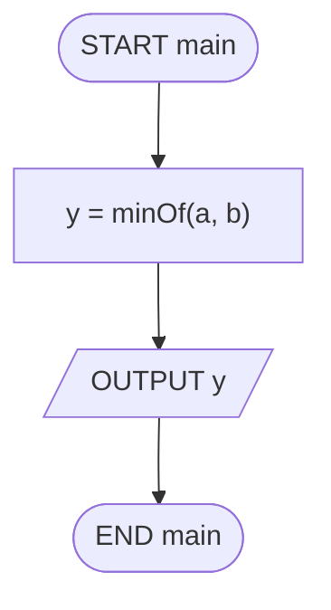

# Séance 6 — Fonctions et procédures

<nav class="page-nav">
  <a href="../../index.html">Accueil</a>
  <a href="cours_seance_06.html">Slides</a>
  <a href="quiz_seance_06.html">Quiz</a>
  <a href="exercices_seance_06.html">Exercices</a>
</nav>

## Pourquoi découper ?

Jusqu'ici : un seul bloc qui fait **tout** (lire, calculer, afficher).

Quand l'algo grandit :

- on **copie-colle** le même parcours de tableau,
- on mélange détails et intention,
- on peaufine un endroit et on **casse** un autre.

Idée : découper en **sous-programmes** réutilisables (*modular design*).

## Conception modulaire (*modular design*)

Un gros problème → plusieurs **petits** rôles clairs.

| Sous-programme | Rôle typique |
| --- | --- |
| lire / remplir | obtenir les données |
| calculer | produire un résultat |
| afficher / rapporter | présenter sans recalculer |

Le programme principal (*main program*) **orchestre** : il appelle, il ne réécrit pas tout.

## Deux familles

| Mot-clé | Produit une valeur ? | Usage typique |
| --- | --- | --- |
| `FUNCTION` | **oui** (`RETURN`) | calcul, test, transformation |
| `PROCEDURE` | **non** | afficher, remplir, modifier un effet |

Les deux se lancent avec `CALL` (ou en expression pour une fonction).

## `FUNCTION` : syntaxe

```text
FUNCTION square(x : INTEGER) : INTEGER
  result = x * x
  RETURN result
END FUNCTION
```

- Nom + **paramètres** typés
- Type de la **valeur de retour**
- `RETURN` quitte et **rend** une valeur

Appel :

```text
y = square(5)
OUTPUT y
```

## `PROCEDURE` : syntaxe

```text
PROCEDURE printLabel(label : STRING)
  OUTPUT label
END PROCEDURE
```

- Pas de type de retour
- Pas de `RETURN` de valeur (on peut seulement **finir**)
- Effet : affichage, saisie, mise à jour…

Appel :

```text
CALL printLabel("done")
```

## Paramètres et arguments

| Terme | Sens |
| --- | --- |
| **Paramètre** | nom dans la **définition** (`x` dans `square(x)`) |
| **Argument** | valeur fournie à l'**appel** (`5` dans `square(5)`) |

À l'appel, chaque argument est **lié** au paramètre correspondant (ordre).

```text
FUNCTION sumOf(a : INTEGER, b : INTEGER) : INTEGER
  RETURN a + b
END FUNCTION

total = sumOf(3, 4)   // a ← 3, b ← 4
```

## Utiliser la valeur de retour

Une fonction **s'utilise comme une valeur** :

```text
total = sumOf(10, 20)
OUTPUT sumOf(1, 2)
IF sumOf(x, y) > limit THEN
  …
END IF
```

Une procédure **ne s'écrit pas** à droite d'un `=` :

```text
CALL printLabel("ok")   // correct
msg = printLabel("ok")  // incorrect
```

## Portée (*scope*) : local

Variables **déclarées dans** la fonction / procédure : **locales**.

```text
FUNCTION double(n : INTEGER) : INTEGER
  temp = n * 2
  RETURN temp
END FUNCTION
```

`temp` n'existe **que** pendant l'exécution de `double`.  
Après le `RETURN`, on ne peut plus lire `temp` depuis le main.

## Portée : global (piège)

Une variable du **main** (ou « globale ») est visible partout si on n'y prend pas garde.

Risque : une procédure **écrase** une globale sans qu'on s'en rende compte.

Bonne pratique débutant :

- préférer **paramètres** + **retour**,
- limiter les globales,
- nommer clairement ce qui est local.

## Exemple : fonction simple

```text
FUNCTION minOf(a : INTEGER, b : INTEGER) : INTEGER
  IF a < b THEN
    RETURN a
  ELSE
    RETURN b
  END IF
END FUNCTION
```

`minOf(8, 3)` → `3`.  
`minOf` **calcule** : c'est une `FUNCTION`.

## Exemple : procédure simple

```text
PROCEDURE showPair(left : INTEGER, right : INTEGER)
  OUTPUT left, right
END PROCEDURE
```

`CALL showPair(2, 9)` affiche les deux valeurs.  
Aucun résultat à récupérer : c'est une `PROCEDURE`.

## Fonction sur tableau : somme

```text
FUNCTION sumArray(values : ARRAY, n : INTEGER) : INTEGER
  sum = 0
  FOR i = 0 TO n - 1 DO
    sum = sum + values[i]
  END FOR
  RETURN sum
END FUNCTION
```

- Indices **0-based** : `0` … `n - 1`
- `n` = taille passée en paramètre
- Le main **réutilise** `sumArray` sans recopier la boucle

## Fonction sur tableau : compter les égaux

```text
FUNCTION countEquals(values : ARRAY, n : INTEGER, target : INTEGER) : INTEGER
  count = 0
  FOR i = 0 TO n - 1 DO
    IF values[i] = target THEN
      count = count + 1
    END IF
  END FOR
  RETURN count
END FUNCTION
```

Même squelette de parcours S5, **encapsulé** dans une fonction.

## Squelette : main + functions

```text
FUNCTION sumArray(values : ARRAY, n : INTEGER) : INTEGER
  …
END FUNCTION

FUNCTION countEquals(values : ARRAY, n : INTEGER, target : INTEGER) : INTEGER
  …
END FUNCTION

// main
INPUT n
FOR i = 0 TO n - 1 DO
  INPUT values[i]
END FOR
INPUT target
total = sumArray(values, n)
hits = countEquals(values, n, target)
OUTPUT total, hits
```

Le main **lit**, **appelle**, **affiche**.

## Trace d'un appel

```text
y = minOf(8, 3)
```

| Étape | Détail |
| --- | --- |
| Entrée | `a = 8`, `b = 3` |
| Test | `8 < 3` → No |
| `RETURN` | `b` soit `3` |
| Retour au main | `y = 3` |

Le corps de `minOf` s'exécute, puis le fil **reprend** juste après l'appel.

## Idée en *flowchart* (appel)

Le main descend vers un sous-programme, puis **revient**.



Le détail de `minOf` est **ailleurs** (autre flowchart / autre bloc *pseudocode*).  
Ne pas tout dessiner dans le même losange.

## Checklist

1. Ai-je besoin d'une **valeur** → `FUNCTION` + `RETURN` ?
2. Seulement un **effet** (afficher, remplir) → `PROCEDURE` + `CALL` ?
3. Paramètres typés, arguments dans le **bon ordre** ?
4. Locals vs globals : qui peut **modifier** quoi ?
5. Tableaux : passer `values` **et** `n`, indices `0..n-1` ?

## Synthèse

| Idée | À retenir |
| --- | --- |
| Modulariser | un rôle = un sous-programme |
| `FUNCTION` | calcule et `RETURN` une valeur |
| `PROCEDURE` | effet, pas de valeur de retour |
| `CALL` / arguments | lancer avec les bonnes valeurs |
| *Scope* | local préférable aux globales fragiles |
| Main | orchestre : lit, appelle, affiche |

## Quiz

Questions pour tester la compréhension du contenu de la séance.

[Quiz](quiz_seance_06.html)

## Exercice 6.A : FUNCTION ou PROCEDURE ?

Classer trois blocs inédits (prix TTC, signal répété, lettre de score).

[Exercices](exercices_seance_06.html) § 6.A

## Exercice 6.B : `clamp`

Borner `x` dans `[lo, hi]` : écrire `FUNCTION clamp` et tracer trois appels.

[Exercices](exercices_seance_06.html) § 6.B

## Exercice 6.C : `factorial`

Écrire `factorial(n)` (`n >= 0`) avec une boucle, puis un main qui lit `n` et affiche `n!`.

[Exercices](exercices_seance_06.html) § 6.C

## Exercice 6.D : `digitSum`

Somme des chiffres d’un entier (`DIV` / `MOD`), sans tableau.

[Exercices](exercices_seance_06.html) § 6.D

## Exercice 6.E : Bug de *scope* (`best`)

Corriger une procédure qui écrase le meilleur score du main.

[Exercices](exercices_seance_06.html) § 6.E

<nav class="page-nav">
  <a href="../../index.html">Accueil</a>
  <a href="cours_seance_06.html">Slides</a>
  <a href="quiz_seance_06.html">Quiz</a>
  <a href="exercices_seance_06.html">Exercices</a>
</nav>

<footer class="site-footer"><a href="mailto:shuraux@he2b.be">Sylvain Huraux - HE2B - ISIB</a></footer>
