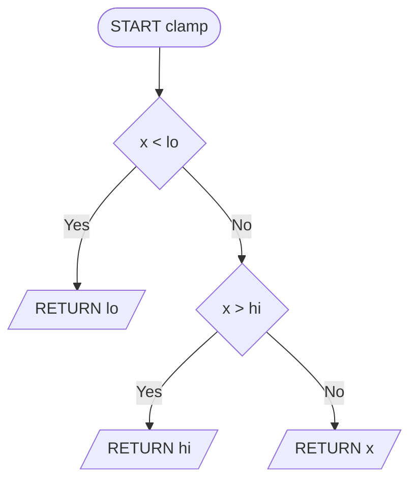

# Séance 7 — Exercices

**Thème :** Fonctions et procédures  
**Support :** *pseudocode* (`FUNCTION` / `PROCEDURE` / `CALL` / `RETURN`) + *trace table* (texte FR, *pseudocode* EN)

Dans les *flowcharts* : pas de littéraux numériques (les valeurs concrètes apparaissent **uniquement** dans la *trace table*).

<nav class="page-nav">
  <a href="../../index.html">Accueil</a>
  <a href="cours_seance_07.html">Slides</a>
  <a href="syllabus_seance_07.html">Syllabus</a>
  <a href="quiz_seance_07.html">Quiz</a>
</nav>

## 7.A : FUNCTION ou PROCEDURE ?

Pour chaque bloc, dire si c'est plutôt une **`FUNCTION`** ou une **`PROCEDURE`**, et pourquoi (une phrase).

**Bloc 1 : prix TTC**

```text
…(priceHT : REAL, rate : REAL)…
  priceTTC = priceHT * (1 + rate)
  RETURN priceTTC
```

**Bloc 2 : signal répété**

```text
…(times : INTEGER)…
  i = 1
  WHILE i <= times DO
    OUTPUT "beep"
    i = i + 1
  END WHILE
```

**Bloc 3 : lettre de score**

```text
…(score : INTEGER)…
  IF score >= 50 THEN
    RETURN "P"
  ELSE
    RETURN "F"
  END IF
```

<details class="corrige">
<summary>Corrigé</summary>

| Bloc | Choix | Pourquoi |
| --- | --- | --- |
| 1 | `FUNCTION` | Calcule et **renvoie** un prix TTC |
| 2 | `PROCEDURE` | Affiche seulement (`beep`), pas de valeur à récupérer |
| 3 | `FUNCTION` | Renvoie une lettre (`"P"` / `"F"`) via `RETURN` |

</details>

---

## 7.B : `clamp`

Écrire une fonction qui **borne** une valeur dans un intervalle fermé `[lo, hi]` (on suppose `lo <= hi`).

```text
FUNCTION clamp(x : INTEGER, lo : INTEGER, hi : INTEGER) : INTEGER
  …
END FUNCTION
```

Règle :

- si `x < lo` → renvoyer `lo`
- si `x > hi` → renvoyer `hi`
- sinon → renvoyer `x`

**Données de trace :** `clamp(-2, 0, 10)`, `clamp(4, 0, 10)`, `clamp(15, 0, 10)`.

1. Écrire le corps complet.
2. Donner les trois valeurs renvoyées.
3. (Optionnel) Esquisse du *flowchart* de `clamp` seul (sans littéraux).

<details class="corrige">
<summary>Corrigé</summary>

```text
FUNCTION clamp(x : INTEGER, lo : INTEGER, hi : INTEGER) : INTEGER
  IF x < lo THEN
    RETURN lo
  ELSE IF x > hi THEN
    RETURN hi
  ELSE
    RETURN x
  END IF
END FUNCTION
```

| Appel | Résultat |
| --- | ---: |
| `clamp(-2, 0, 10)` | `0` |
| `clamp(4, 0, 10)` | `4` |
| `clamp(15, 0, 10)` | `10` |



</details>

---

## 7.C : `factorial`

Écrire une fonction qui calcule `n!` pour un entier `n >= 0`  
(`0! = 1`, `1! = 1`, `2! = 2`, `3! = 6`, …) avec une boucle (pas de récursivité).

Puis un **main** qui lit `n`, appelle `factorial`, affiche le résultat.

**Données de trace :** `n = 4`.

1. Écrire `FUNCTION factorial(n : INTEGER) : INTEGER`.
2. Écrire le main.
3. Compléter une *trace* du corps pour `n = 4` (colonnes `i`, `result`).

<details class="corrige">
<summary>Corrigé</summary>

```text
FUNCTION factorial(n : INTEGER) : INTEGER
  result = 1
  FOR i = 1 TO n DO
    result = result * i
  END FOR
  RETURN result
END FUNCTION

// main
INPUT n
value = factorial(n)
OUTPUT value
```

Trace pour `n = 4` :

| `i` | `result` après le tour |
| ---: | ---: |
| (init) | 1 |
| 1 | 1 |
| 2 | 2 |
| 3 | 6 |
| 4 | 24 |

**OUTPUT 24**.  
Si `n = 0`, le `FOR` ne tourne pas → `RETURN 1`.

</details>

---

## 7.D : `countChar`

Écrire une fonction qui compte combien de fois le caractère `target` apparaît dans la chaîne `text` (même idée qu’en S6, encapsulée).

```text
FUNCTION countChar(text : STRING, target : STRING) : INTEGER
  …
END FUNCTION
```

**Données de trace :** `countChar("banana", "a")`.

1. Écrire le corps complet (`LENGTH` + `FOR` + compteur).
2. Compléter une *trace table* (`i`, `text[i]`, égal ?, `count`).
3. Que vaut `countChar("", "x")` ?

<details class="corrige">
<summary>Corrigé</summary>

```text
FUNCTION countChar(text : STRING, target : STRING) : INTEGER
  n = LENGTH(text)
  count = 0
  FOR i = 0 TO n - 1 DO
    IF text[i] = target THEN
      count = count + 1
    END IF
  END FOR
  RETURN count
END FUNCTION
```

Trace pour `"banana"`, `"a"` :

| `i` | `text[i]` | égal ? | `count` |
| ---: | :---: | --- | ---: |
| (init) | | | 0 |
| 0 | b | No | 0 |
| 1 | a | Yes | 1 |
| 2 | n | No | 1 |
| 3 | a | Yes | 2 |
| 4 | n | No | 2 |
| 5 | a | Yes | 3 |

**RETURN 3**.  
`countChar("", "x")` → **`0`** (`n = 0`, boucle inactive).

</details>

---

## 7.E : Bug de *scope* (`best`)

Le main garde le **meilleur score** vu jusqu’ici. L’extrait est incorrect.

```text
best = 12

PROCEDURE updateBest(score : INTEGER)
  best = score
END PROCEDURE

OUTPUT best
CALL updateBest(9)
OUTPUT best
```

Intention pédagogique du programmeur : afficher `12`, puis **garder** `12` si `9` n’est pas meilleur (donc n’écraser que si `score > best`).

1. Qu’affiche-t-on **tel quel** (globale `best`) ?
2. Quel est le défaut (portée + logique) ?
3. Corriger : soit une `FUNCTION` qui **renvoie** le nouveau meilleur sans écraser à l’aveugle, soit une procédure avec la bonne condition. Le main doit finir avec `best = 12` pour cet appel.

<details class="corrige">
<summary>Corrigé</summary>

1. Affichage : `12`, puis `9` (la procédure a **toujours** écrasé la globale).
2. Défauts : effet de bord sur une **globale**, et pas de test `score > best`.
3. Correction recommandée (`FUNCTION` + affectation explicite dans le main) :

```text
FUNCTION better(bestSoFar : INTEGER, score : INTEGER) : INTEGER
  IF score > bestSoFar THEN
    RETURN score
  ELSE
    RETURN bestSoFar
  END IF
END FUNCTION

// main
best = 12
OUTPUT best
best = better(best, 9)
OUTPUT best
```

Affichage : `12`, `12`.  
Avec `CALL`-style procédure, il faudrait au minimum `IF score > best THEN best = score` **et** une discipline claire sur qui possède `best` (idéalement le main seulement).

</details>

<footer class="site-footer"><a href="mailto:shuraux@he2b.be">Sylvain Huraux - HE2B - ISIB</a></footer>
