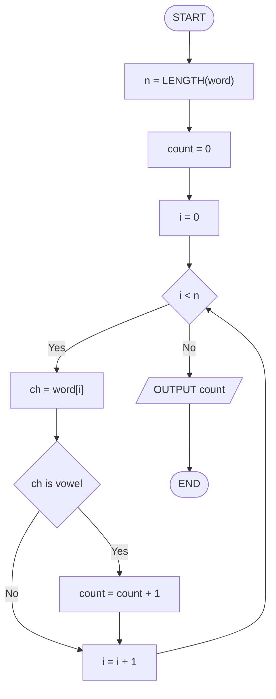
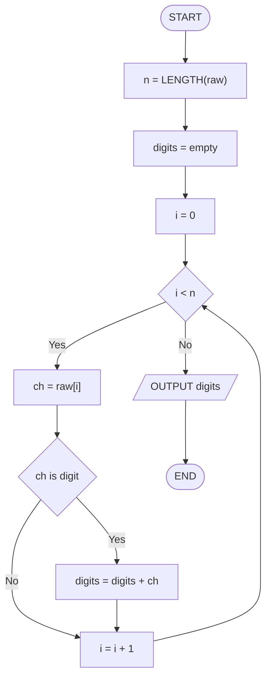
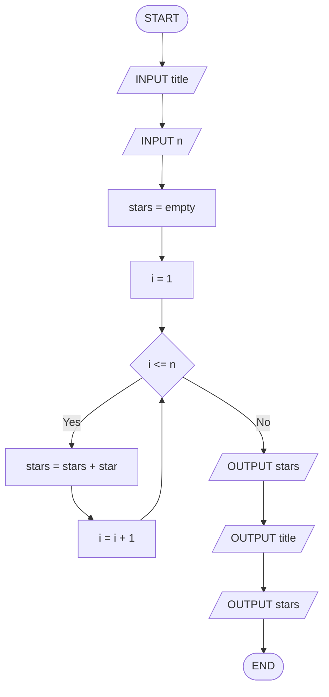

# Séance 7 — Exercices

**Thème :** Chaînes et caractères  
**Support :** *pseudocode* (`LENGTH`, indices, parcours, concaténation) + *trace table* (texte FR, *pseudocode* et *flowcharts* EN)

Dans les *flowcharts* : pas de littéraux numériques ni de chaînes concrètes (les valeurs apparaissent **uniquement** dans la *trace table*).

<nav class="page-nav">
  <a href="../../index.html">Accueil</a>
  <a href="cours_seance_07.html">Slides</a>
  <a href="syllabus_seance_07.html">Syllabus</a>
  <a href="quiz_seance_07.html">Quiz</a>
</nav>

## 7.A : Compter les voyelles

Chaîne `word` (minuscules). Compter combien de caractères sont une **voyelle** parmi `a`, `e`, `i`, `o`, `u` (pas `y`). Afficher ce compte.

**Données de trace :** `word = "education"`.

1. Compléter une *trace table* (colonnes `i`, `word[i]`, voyelle ?, `count`).
2. Écrire le *pseudocode* (`LENGTH` + `FOR` + tests).
3. (Optionnel) Esquisse du *flowchart* (sans coller les littéraux de la trace).

<details class="corrige">
<summary>Corrigé</summary>

Voyelles dans `"education"` : `e`, `u`, `a`, `i`, `o` → **OUTPUT 5**.

| `i` | `word[i]` | voyelle ? | `count` |
| ---: | :---: | --- | ---: |
| (init) | | | 0 |
| 0 | e | Yes | 1 |
| 1 | d | No | 1 |
| 2 | u | Yes | 2 |
| 3 | c | No | 2 |
| 4 | a | Yes | 3 |
| 5 | t | No | 3 |
| 6 | i | Yes | 4 |
| 7 | o | Yes | 5 |
| 8 | n | No | 5 |

```text
n = LENGTH(word)
count = 0
FOR i = 0 TO n - 1 DO
  ch = word[i]
  IF ch = "a" OR ch = "e" OR ch = "i" OR ch = "o" OR ch = "u" THEN
    count = count + 1
  END IF
END FOR
OUTPUT count
```



</details>

---

## 7.B : Inverser une chaîne

Chaîne `text`. Construire une nouvelle chaîne `rev` qui contient les caractères de `text` **dans l'ordre inverse**. Afficher `rev`.

**Données de trace :** `text = "method"`.

1. Quelle est la valeur finale de `rev` ?
2. Écrire le *pseudocode* (boucle qui part de la fin, ou boucle croissante avec `text[n - 1 - i]`).
3. *Edge :* que se passe-t-il si `text = ""` ?

<details class="corrige">
<summary>Corrigé</summary>

**OUTPUT `dohtem`**.

```text
n = LENGTH(text)
rev = ""
FOR i = n - 1 TO 0 STEP -1 DO
  rev = rev + text[i]
END FOR
OUTPUT rev
```

Variante (indices croissants) :

```text
n = LENGTH(text)
rev = ""
FOR i = 0 TO n - 1 DO
  rev = rev + text[n - 1 - i]
END FOR
OUTPUT rev
```

Si `text = ""` : `n = 0`, la boucle ne tourne pas, `rev` reste `""`.

| `i` (STEP -1) | `text[i]` | `rev` |
| ---: | :---: | --- |
| (init) | | `""` |
| 5 | d | `"d"` |
| 4 | o | `"do"` |
| 3 | h | `"doh"` |
| 2 | t | `"doht"` |
| 1 | e | `"dohte"` |
| 0 | m | `"dohtem"` |

</details>

---

## 7.C : Palindrome (deux pointeurs), trace

On utilise l'algorithme à **deux pointeurs** vu en cours (`left`, `right`, `isPal`).

**Données de trace A :** `text = "level"`.  
**Données de trace B :** `text = "lemma"`.

1. Pour A : remplir une *trace table* (`left`, `right`, caractères comparés, `isPal`) jusqu'à l'arrêt. Résultat ?
2. Pour B : à quelle étape `isPal` devient `FALSE` ? Résultat final ?
3. Écrire le *pseudocode* complet (rappel fidèle de l'algo du cours).

<details class="corrige">
<summary>Corrigé</summary>

**A.** `"level"` (`n = 5`) → **TRUE**

| Étape | `left` | `right` | Comparaison | `isPal` |
| ---: | ---: | ---: | --- | --- |
| 1 | 0 | 4 | `l` = `l` | TRUE |
| 2 | 1 | 3 | `e` = `e` | TRUE |
| 3 | 2 | 2 | stop (`left < right` faux) | TRUE |

**B.** `"lemma"` (`n = 5`) → **FALSE**

| Étape | `left` | `right` | Comparaison | `isPal` |
| ---: | ---: | ---: | --- | --- |
| 1 | 0 | 4 | `l` = `a` ? **No** | FALSE |

Dès la première paire différente, on s'arrête.

```text
n = LENGTH(text)
left = 0
right = n - 1
isPal = TRUE
WHILE left < right AND isPal DO
  IF text[left] <> text[right] THEN
    isPal = FALSE
  ELSE
    left = left + 1
    right = right - 1
  END IF
END WHILE
OUTPUT isPal
```

</details>

---

## 7.D : Filtrer les chiffres

Chaîne `raw` (lettres, chiffres, éventuellement autres symboles). Construire `digits` en **ne gardant que** les caractères chiffres `"0"` … `"9"`, dans le même ordre. Afficher `digits`.

Un caractère `ch` est un chiffre si `"0" <= ch AND ch <= "9"` (ordre lexicographique des caractères chiffres).

**Données de trace :** `raw = "a1b23c"`.

1. Valeur finale de `digits` ?
2. *Pseudocode* (parcours + concaténation conditionnelle).
3. *Edge :* `raw = "hello"` → que vaut `digits` ?

<details class="corrige">
<summary>Corrigé</summary>

**OUTPUT `123`**.

Si `raw = "hello"` : aucun chiffre → `digits = ""`.

| `i` | `raw[i]` | chiffre ? | `digits` |
| ---: | :---: | --- | --- |
| (init) | | | `""` |
| 0 | a | No | `""` |
| 1 | 1 | Yes | `"1"` |
| 2 | b | No | `"1"` |
| 3 | 2 | Yes | `"12"` |
| 4 | 3 | Yes | `"123"` |
| 5 | c | No | `"123"` |

```text
n = LENGTH(raw)
digits = ""
FOR i = 0 TO n - 1 DO
  ch = raw[i]
  IF ch >= "0" AND ch <= "9" THEN
    digits = digits + ch
  END IF
END FOR
OUTPUT digits
```



(`empty` = `""` : valeur seulement dans la *trace*.)

</details>

---

## 7.E : Encadrer un titre

Lire une chaîne `title` et un entier `n` (`n >= 0`). Afficher **trois** lignes :

1. une ligne de `n` caractères `"*"`
2. la chaîne `title`
3. une autre ligne de `n` caractères `"*"`

**Données de trace :** `title = "ISIB"`, `n = 5`.

1. Que s'affiche-t-il exactement (trois lignes) ?
2. Écrire le *pseudocode* (construire la ligne d'étoiles **une fois**, puis l'afficher deux fois, **ou** deux boucles séparées).
3. *Edge :* `n = 0` → que devient la ligne d'étoiles ?

<details class="corrige">
<summary>Corrigé</summary>

Affichage :

```text
*****
ISIB
*****
```

Si `n = 0` : la ligne d'étoiles est la chaîne vide (ligne blanche / vide selon le support d'affichage).

```text
INPUT title
INPUT n
stars = ""
FOR i = 1 TO n DO
  stars = stars + "*"
END FOR
OUTPUT stars
OUTPUT title
OUTPUT stars
```

Variante sans stocker `stars` (deux boucles d'affichage caractère par caractère) possible, mais construire une fois évite la duplication.



(`empty` = `""`, `star` = `"*"`.)

</details>

---

<nav class="page-nav">
  <a href="../../index.html">Accueil</a>
  <a href="cours_seance_07.html">Slides</a>
  <a href="syllabus_seance_07.html">Syllabus</a>
  <a href="quiz_seance_07.html">Quiz</a>
</nav>

<footer class="site-footer"><a href="mailto:shuraux@he2b.be">Sylvain Huraux - HE2B - ISIB</a></footer>
